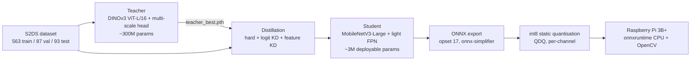

Concrete defect segmentation for an inspection robot: DINOv3 ViT-L teacher (0.81 test mIoU) distilled into a ~3M-parameter MobileNetV3 student (0.75 val mIoU), with an int8 export path for Raspberry Pi.

# Concrete Defect Segmentation for an Inspection Robot (DINOv3 → MobileNetV3 → Raspberry Pi)

Multi-class semantic segmentation of concrete surface defects (cracks, spalling, corrosion, efflorescence, vegetation, control points), built for an **AI-based concrete inspection robot**. A large DINOv3 ViT-L/16 **teacher** is fine-tuned on the S2DS dataset, which is then **distilled into a small MobileNetV3 student** (about 3M parameters) intended for int8 quantisation and a **Raspberry Pi 3B+**.

> **Status:** teacher fine-tuning and student distillation are complete, with measured results below. The ONNX/int8 export and on-device Raspberry Pi benchmarking are implemented but **their results are not yet included** (see [Status and limitations](#status-and-limitations)).

## Results

### Stage 1: frozen DINOv3-L backbone, head-only baseline (`notebooks/01_frozen_dinov3_baseline.ipynb`)

One epoch on a Tesla T4, 256×256 crops, backbone frozen, ~4.5M-parameter head trained with cross-entropy.

| Class | Validation IoU |
|---|---:|
| Background | 0.966 |
| Crack | 0.153 |
| Spalling | 0.714 |
| Corrosion | 0.379 |
| Efflorescence | 0.539 |
| Vegetation | 0.608 |
| Control point | 0.767 |
| **mIoU** | **0.589** |

### Stage 2: fine-tuned teacher (`notebooks/02_teacher_finetuning_dinov3.ipynb`)

Official S2DS evaluation protocol (full 1024 px images), best-validation checkpoint.

| Class | Val IoU (best) | Test IoU |
|---|---:|---:|
| Background | 0.982 | 0.984 |
| Crack | 0.202 | 0.222 |
| Spalling | 0.882 | 0.936 |
| Corrosion | 0.872 | 0.858 |
| Efflorescence | 0.838 | 0.872 |
| Vegetation | 0.736 | 0.828 |
| Control point | 0.990 | 0.979 |
| **mIoU (all 7)** | **0.786** | **0.811** |

Cracks are 1 to 2 px wide, so strict pixel IoU punishes a one-pixel shift as a miss. Test-set crack IoU with a line tolerance:

| Tolerance | 0 px | 2 px | 4 px | 8 px |
|---|---:|---:|---:|---:|
| Crack IoU | 0.085 | 0.490 | 0.763 | 0.889 |

Thin-crack segmentation is the main open problem and the reason the roadmap focuses on class-imbalance-aware losses.

### Stage 3: distilled student (MobileNetV3)

25 epochs of distillation from the fine-tuned teacher, evaluated on the S2DS validation split with the official protocol (full 1024 px images). The teacher is re-evaluated inside the distillation run, so its numbers differ from Stage 2 by about 0.001.

| Class | Teacher (val) | Student (val) |
|---|---:|---:|
| Background | 0.982 | 0.977 |
| Crack | 0.202 | 0.237 |
| Spalling | 0.882 | 0.811 |
| Corrosion | 0.872 | 0.831 |
| Efflorescence | 0.837 | 0.696 |
| Vegetation | 0.735 | 0.708 |
| Control point | 0.989 | 0.992 |
| **mIoU (all 7)** | **0.785** | **0.750** |
| mIoU (defect classes only) | 0.753 | 0.712 |

The student keeps about 95 % of the teacher's validation mIoU at roughly 1 % of its size (about 3M versus about 300M parameters). Efflorescence loses the most (0.837 to 0.696). Crack IoU is slightly higher for the student on this split, but both are low, so treat that difference with caution. These are float-model results. The int8-quantised accuracy has not been measured here yet.

Distillation settings: MobileNetV3-Large student, decoder width 96, 384 px training crop at 0.5 scale (512 px deploy size), batch 8, encoder LR 3e-4, head LR 1e-3, KD temperature 2, loss weights 1.0 (hard) / 1.0 (logit KD) / 0.25 (feature KD), EMA decay 0.999, seed 0.

## Architecture

### End-to-end pipeline



### Teacher


- **Backbone:** DINOv3 ViT-L/16 (~302M params), pretrained weights from Hugging Face.
- **Head:** multi-scale segmentation head (~4.5M params), 7 output classes.
- **Training presets** are chosen from the available GPU. Full fine-tuning (all 24 blocks, 768 px crops, bf16, gradient checkpointing) needs a large GPU such as an L4 or A100. On a 16 GB T4 the notebook falls back to fine-tuning only the last 4 blocks at 512 px.
- **Resume:** training resumes automatically from the last saved checkpoint after a Colab disconnect.

### Student and distillation

- **Student options:** `mobilenet` (MobileNetV3-Large encoder via `timm`, light FPN decoder, ~3.1M deployable params, output stride 4, recommended for the Pi) or `vits` (DINOv3 ViT-S/16, ~21.7M params, closer to the teacher but much slower on the Pi).
- **Loss:** a weighted sum of three terms, all computed on the same augmented crop.
  1. Hard loss: focal + Dice against the human labels.
  2. Logit distillation: KL divergence between softened teacher and student logits (temperature 2).
  3. Feature distillation: MSE between the student's stride-16 feature map (projected to the teacher's 1024-d space) and the teacher's last-layer features, after layer normalisation. This projection is dropped at export time.
- **Resolution trick:** the teacher sees the crop at native resolution (so it can still see hairline cracks) while the student sees a downscaled version (the resolution it will use on the Pi). The student learns to reproduce high-resolution teacher quality from a low-resolution input.
- **Training details:** AdamW with separate encoder and head learning rates, cosine schedule with warmup, EMA of student weights, class weights from training-set pixel counts.
- **Export:** ONNX (opset 17, simplified), then int8 static QDQ quantisation with per-channel weights, calibrated on 100 training images. Evaluation always happens at full 1024 px against the official protocol so student and teacher numbers are directly comparable.
- **On-device inference:** a small script that needs only `onnxruntime`, `numpy` and `opencv-python-headless`. It letterboxes any photo to the model input, runs the model, upsamples the low-resolution logits, saves a colour overlay and reports per-defect area and latency.

## Dataset and credits

- **Dataset:** S2DS (7 classes: background, crack, spalling, corrosion, efflorescence, vegetation, control point). Official split: 563 train, 87 validation, 93 test images.
- **Reference implementation:** the model code (`model.py`), dataset loader and official metric (`s2ds_data.py`) and loss (`losses.py`) come from the public repository [`A-SHOJAEI/s2ds-defect-segmentation`](https://github.com/A-SHOJAEI/s2ds-defect-segmentation), which the notebooks clone at runtime. The teacher training script follows that repo's recipe and adds GPU presets, partial fine-tuning for smaller GPUs and automatic resume.
- **Original work in this project:** the Colab workflow, GPU presets and resume logic, the frozen-backbone baseline analysis, the student architecture, the distillation losses, the quantisation and export pipeline, and the Raspberry Pi inference script.

## Repository layout

```
.
├── README.md
├── requirements.txt
├── .gitignore
└── notebooks/
    ├── 01_frozen_dinov3_baseline.ipynb      # head-only baseline, mIoU 0.589
    ├── 02_teacher_finetuning_dinov3.ipynb   # teacher fine-tuning and evaluation, test mIoU 0.811
    └── 03_distill_export_pi.ipynb           # TODO: add (student distillation, ONNX/int8 export, Pi package)
```

## How to run

The notebooks are written for **Google Colab with a GPU runtime**.

1. Open `notebooks/01_frozen_dinov3_baseline.ipynb` in Colab and run all cells. It downloads the dataset and clones the reference repo.
2. Open `notebooks/02_teacher_finetuning_dinov3.ipynb`, choose a GPU runtime, and run top to bottom. The first run downloads DINOv3-L weights (~1.2 GB). If you get a 401/403 error, accept the DINOv3 licence on Hugging Face and log in with `huggingface_hub.login()`.
3. The best teacher checkpoint is saved to `MyDrive/concrete_inspection/teacher/teacher_best.pth`.

Local setup (optional): `pip install -r requirements.txt`

## Status and limitations

- Teacher fine-tuning and evaluation: **done** (test mIoU 0.811).
- Student distillation: **done** (validation mIoU 0.750, float model).
- ONNX/int8 export and on-device Raspberry Pi benchmarking: implemented, **results not yet reported**. No int8 accuracy or Pi latency numbers are claimed here.
- Student numbers are on the validation split only. A test-split evaluation of the student is still to do.
- Crack segmentation remains weak under strict IoU (0.22 on test for the teacher). Planned work: Dice/Focal losses tuned for thin structures, longer training, a pretrained U-Net baseline for comparison, and a MobileNetV3-U-Net candidate for the Pi.
- Results come from a single run and a single seed.
